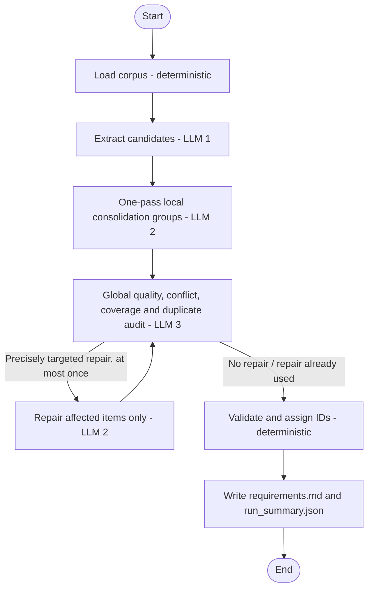

# Agentic network design report

## Goal and architecture

The application turns a configurable folder of heterogeneous requirement
documents into one traceable Markdown specification. The implementation is a
compiled LangGraph state graph in `requirements_agent/network.py`, not a
plain sequential script.

## Nodes, models, and feedback

| Node | Kind | Responsibility |
|---|---|---|
| `load` | Deterministic | Recursively loads `.txt` and `.eml`, preserves email headers, tracks load issues and a source manifest, and excludes output files. |
| `extract` | LLM | Extracts atomic, evidence-backed candidates in batches. Captures category, evidence, source, priority and rejected candidates. |
| `consolidate` | LLM | Deduplicates semantically equivalent statements, preserves independent requirements and sources, normalizes language, and records conflicts as questions. |
| `review` | LLM | Audits the complete input against candidate and final requirement sets; identifies omissions, unsupported claims, duplicates, conflicts and coverage gaps. |
| `validate` | Deterministic | Checks required fields, priority values and known source references; assigns stable sequential `REQ-###` and `BL-###` IDs. |
| Output writer | Deterministic | Renders the main Markdown document and JSON run summary. |

Default models are `gpt-5.4-nano` for extraction, `gpt-5-mini` for
consolidation and `gpt-5-nano` for review. They are independently
configurable via environment variables. The preflight call checks access and
does not fall back to another model. `OPENAI_BASE_URL` supports providers that
require a custom endpoint.

Extraction batches default to at most 12,000 source characters and can be
changed with `--extraction-batch-chars`. The limit also splits long individual
documents while retaining their source filename. The global review receives
compact indexes and evidence snippets, not full source documents.

Successful extraction results are atomically cached in
`<output-dir>/.cache/extraction_cache.json`. A cache entry is reusable only
when the exact batch document IDs, names and contents, extraction model ID,
extraction prompt version and review-feedback context match. The prompt
version is a code constant that must be incremented when extraction
instructions change. The API key is never included in the cache. Cache writes
happen after each successful batch,
so a later failure can resume without repeating completed extraction calls.
Final requirements and run-summary documents are written only after the
entire graph succeeds and deterministic validation reports no errors. Calls
have a 90-second timeout and one bounded SDK retry.

Consolidation uses one pass over configurable groups of up to 45 candidates
(`--consolidation-batch-size`). Each group merges only true semantic
duplicates, preserves independent obligations and source evidence, and
normalizes terminology. A single global review compares compact indexes from
all groups to identify cross-group duplicates, missing coverage, unsupported
claims, conflicts, and completeness gaps. No further consolidation stage is
started merely because the output count did not decrease.

Successful local and targeted repair groups are cached in
`<output-dir>/.cache/consolidation_cache.json`. Cache keys include the
candidate data, model, prompt version, phase/group, source manifest, and
feedback context. The consolidation prompt version was incremented for the
algorithm change, invalidating incompatible consolidation results while
preserving extraction cache compatibility. Internal candidate references let
the graph deterministically reattach source documents and evidence. Source
names are accepted only if present in the input manifest. A referenced e-mail
address is mapped to a unique input `.eml` header, or, if necessary, a unique
document containing the candidate's evidence. Sources returned by the
consolidation model are not trusted for final provenance. If a source cannot
be recovered reliably, it is left blank, marked for manual review, and
reported as a non-blocking validation warning rather than guessed.
Candidates omitted by the model from both accepted and rejected outputs are
retained as standalone requirements. Consolidation cache keys use the original
candidate inputs, allowing compatible prior group results to be reused while
the deterministic provenance mapping is refreshed.

Review findings trigger at most one repair pass and only when they identify
exact requirement IDs or candidate references. Repairs are divided into
bounded groups and only the flagged items are sent back to the consolidation
model; the repaired result is reviewed once more. Findings that are not
actionable or remain after repair are retained as unresolved questions for
human review. The CLI allows `--max-iterations` of 0 or 1 (default 1).

At the default group size, 368 candidates require about nine local
consolidation calls. The graph makes one global review call; if a targeted
repair is needed, it calls the consolidation model only for affected groups
(typically one) and then performs one final review. Preflight uses three
additional calls, and extraction calls depend on the uncached source batches.
These are call-count estimates, not claims of a live model run.

## Quality and output

- Deduplication and consistent language are requested of the consolidation
  model and independently examined by the review model.
- Source filenames and evidence travel with each candidate and consolidated
  requirement; the output includes a coverage table for the full manifest.
- Conflicts that cannot be grounded are left as unresolved questions rather
  than resolved arbitrarily.
- Each requirement has a P1-P4 priority, a rationale and an estimated/source-
  supported marker. The scale is explained in `requirements.md`.
- Rejected candidates have their own blacklist entries and reasons.
- Deterministic validation reports missing fields, invalid priorities and
  unknown source references; it does not fabricate missing content.

## Safe API configuration

The key is loaded from `OPENAI_API_KEY` or an ignored local `.env`, otherwise
requested using `getpass.getpass()` and kept only in the process environment.
No key is stored in source, prompts, outputs or reports. Error messages redact
the configured key. `.env.example` contains no secret. Timestamped progress
logs report workflow phases, model calls, batches, durations and long waits
without logging document text or prompts.

## Installation and execution

Install with `python -m pip install -r requirements.txt`. Run from this
directory with `python main.py --input-dir .\data\corpus --output-dir .\output`.
The output is written only after an actual graph run; an API-unavailable
fallback document is not generated.

## Tests and execution status

The automated tests use mock LLM outputs to exercise corpus loading, email
metadata, output-directory exclusion, targeted feedback routing, the single
repair limit, source traceability, deterministic ID assignment, batch
splitting, extraction cache invalidation and resumption after timeout,
single-pass consolidation, cross-group duplicate review, provenance
retention, consolidation cache invalidation, and recovery from a failed
group. They are offline tests, not proof of model quality or API
connectivity. The provided corpus run must still be performed with a valid
API key and accessible configured models. A real
model-generated `output/requirements.md` must not be claimed until such a run
succeeds.

## Assignment checklist

| Requirement | Implementation |
|---|---|
| ANS1: 3 LLM nodes | `extract`, `consolidate`, `review` |
| ANS2: deterministic node | `load` and `validate` |
| ANS3: feedback loop | Conditional LangGraph edge from `review`, one targeted repair maximum |
| ANS4: 3 model IDs | Defaults and environment configuration in `cli.py` |
| ANS5: LangGraph | Compiled `StateGraph` in `network.py` |
| OS1: single structured document | `output/requirements.md` |
| OS2: unique requirement IDs | Deterministic `REQ-###` assignment |
| OS3: semantic duplicates | Consolidation prompt and independent review |
| OS4: traceability | Requirement source documents/evidence and coverage table |
| OS5: name and explanation | Requirement heading and statement paragraph |
| OS6: priority and scale | P1-P4 and rationale in each requirement |
| OS7: consistency/conflicts | Consolidation/review prompts and unresolved questions |
| OS8: completeness | Review against documents/candidates and source coverage |
| OS9: blacklist | `BL-###` entries with reasons |
