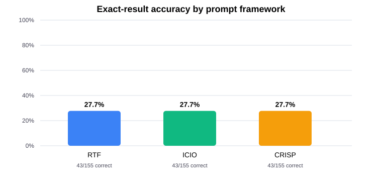
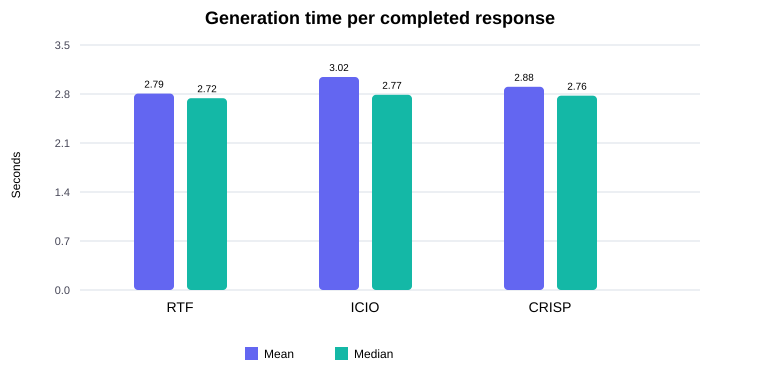

# Task 2: Text-to-SQL Prompt Comparison

## Methodology

The benchmark contains 155 original questions. Each framework was run in its own named GitHub Copilot CLI session, using the corresponding final Task 1 prompt as that session's custom-agent instructions. The original question text and ordering were retained. Reference results and database contents were not sent to the model. Each question was submitted once; no automatic retries were made. The generated SQL, framework, observed model ID, per-request generation time, status, error, and session ID are stored in the framework's CSV.

The authenticated official Copilot SDK model catalog returned only `auto`; the user approved proceeding with automatic routing. The configured model setting for all three sessions was `auto`. Explicit selection of `gpt-6-luna` was not successfully set and was rejected by the CLI, so the model must not be described as pinned. The actual model ID returned with every assistant response was recorded. All successfully generated responses reported `gpt-6-luna`. All responses in this run therefore have the same observed model ID, but automatic routing does not guarantee that ID in future runs.

Generation latency is the interval between the CLI JSON event timestamp for the submitted question and the timestamp of the completed assistant response. CLI startup, dataset loading, and SQL evaluation are excluded. Mean and median generation times use successful generations with a parseable latency; failures are reported separately and are not assigned fabricated latency values.

## Results

Accuracy means **exact result-set accuracy**. It is taken from the unmodified instructor-provided `evaluate_retrieval_predictions.py` script, which executes each predicted query against the supplied SQLite data and compares rows as multisets (including duplicates). The evaluator was run separately for each framework in an isolated temporary directory containing copies of the required inputs; original datasets, predictions, and evaluator were not changed. The original evaluator stops with an error if a prediction cannot be executed, and it does not count failed generations or SQL execution errors as incorrect answers. This workflow therefore aborts without updating metrics, this report, or charts if generation failed or the evaluator encounters an SQL execution error. A reported SQL error count of zero means the original evaluator completed all prediction queries for that framework. Accuracy uses all 155 benchmark questions as its denominator. The authoritative evaluator results match the previously stored metrics for all three frameworks.

| Framework | Questions | Generated | Correct | Accuracy | Mean time (s) | Median time (s) | Failed generations | SQL execution errors observed |
|---|---:|---:|---:|---:|---:|---:|---:|---:|
| RTF | 155 | 155 | 43 | 27.74% | 2.785 | 2.721 | 0 | 0 |
| ICIO | 155 | 155 | 43 | 27.74% | 3.022 | 2.769 | 0 | 0 |
| CRISP | 155 | 155 | 43 | 27.74% | 2.883 | 2.756 | 0 | 0 |

## Interpretation

All three frameworks achieved the same measured accuracy on this benchmark. Generated SQL text differed among frameworks on 24 of 155 questions, but those variations did not change the aggregate correct count. The timing figures differ, but this one-run experiment does not establish that the differences are caused by prompt structure.

RTF had the lowest mean successful-response latency (2.785 s). Timing reflects observed CLI response latency and may vary with network conditions, service load, and automatic model routing.

All 112 incorrect predictions were executable SQL result mismatches; the original evaluator completed every prediction query, so no SQL execution errors or failed generations were observed.

## Generation and SQL issues

- **RTF**: none.
- **ICIO**: none.
- **CRISP**: none.

## Sessions and model IDs

| Framework | Copilot session ID | Configured model setting | Observed model IDs |
|---|---|---|---|
| RTF | `2b34ae28-211f-492f-90c6-6094aa39140c` | `auto` | `gpt-6-luna` |
| ICIO | `7bed5495-3028-4110-82f3-527ddf8c4c2c` | `auto` | `gpt-6-luna` |
| CRISP | `4b93a871-18b2-4f04-b52a-e49dda6383fb` | `auto` | `gpt-6-luna` |

Session IDs, prompt hashes, CLI version, and model-selection notes are also stored in [`data/task2_experiment_metadata.json`](data/task2_experiment_metadata.json). Authoritative evaluator output and the comparison with previously stored metrics are recorded in [`data/task2_metrics.json`](data/task2_metrics.json). Prediction files are [`data/task2_predictions_rtf.csv`](data/task2_predictions_rtf.csv), [`data/task2_predictions_icio.csv`](data/task2_predictions_icio.csv), and [`data/task2_predictions_crisp.csv`](data/task2_predictions_crisp.csv).

## Limitations

- Auto routing (`auto`) was configured because the CLI model catalog did not expose a selectable specific model and explicit selection of `gpt-6-luna` was rejected. In this run, all 465 responses reported `gpt-6-luna`, so the observed model ID did not vary across the three sessions. The model was not pinned, and automatic routing does not guarantee the same model in future runs.
- The experiment uses one run per question and framework. It does not estimate run-to-run stochastic variation or establish statistical significance.
- The examples and task instructions constrain the model, but performance is specific to this benchmark, schema, database, and prompt wording.
- Generation failures and SQL execution errors are not automatically counted as incorrect by the original evaluator. The workflow stops and does not update final metrics, report, or charts unless the complete set of predictions can be evaluated. For this run, every generation succeeded and the evaluator completed all queries.
