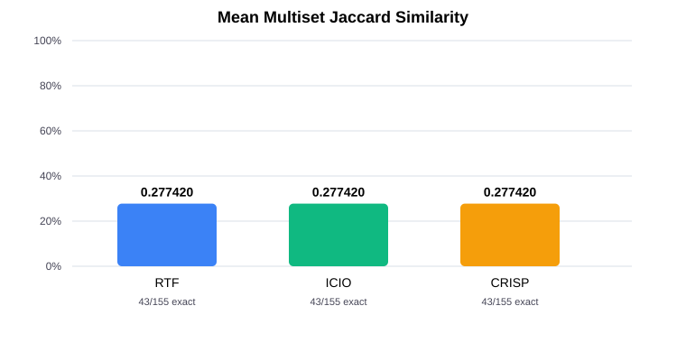

# Task 3: Multiset Jaccard Similarity for Text-to-SQL

## Introduction and motivation

Task 2 evaluated each generated SQL query with exact result-set accuracy: a prediction is correct only when its complete result multiset matches the reference. This is useful for strict correctness, but it gives the same zero credit to a query with nearly all expected rows and one with no matching rows. This report adds a graded measure of result overlap while retaining exact accuracy as the primary all-or-nothing measure.

The Task 2 benchmark contains 155 questions per framework. The configured model setting was `auto`; recorded response model IDs were `gpt-6-luna`. No benchmark sessions were run and no predictions were regenerated for Task 3.

## Metric definition

For each question, let *A* be the multiset of rows returned by the predicted SQL query and *B* be the reference-result multiset. A multiset records each row together with its occurrence count. The Multiset Jaccard Similarity is:

`J(A, B) = sum_r min(c_A(r), c_B(r)) / sum_r max(c_A(r), c_B(r))`

where `c_A(r)` and `c_B(r)` are the multiplicities of row `r` in the predicted and reference results. The numerator is the multiset intersection size; the denominator is the multiset union size. Counting multiplicities means duplicate rows are preserved, consistently with the Task 2 evaluator.

If both result multisets are empty, the union size is zero and the score is defined as 1. If exactly one is empty, the score is 0. Identical multisets, including duplicates, score 1; disjoint multisets score 0; partial overlap scores strictly between 0 and 1. A failed generation or SQL execution error receives score 0 and is separately counted, so it cannot disappear from the fixed denominator of 155.

## Why the metric is appropriate

Text-to-SQL result errors can be incremental: a query may return many of the right rows while missing some rows or including a few extras. Exact accuracy does not distinguish such a result from a wholly unrelated one. Multiset Jaccard gives partial credit for overlap and penalizes both omissions and excess rows. It is interpretable on a 0–1 scale and uses the same executed predictions, database, reference results, row equality, and duplicate-sensitive semantics as the existing evaluator.

This metric **complements and does not replace** exact result accuracy. A score below 1 is not a correct answer under the original benchmark. Exact accuracy remains necessary for strict correctness; the average Jaccard score describes the degree of row overlap among all questions.

## Implementation

`calculate_task3_metric.py` loads the original 155 question/reference pairs and each existing Task 2 prediction CSV, verifies row counts, question order, and framework labels, then builds the SQLite database using the unchanged `load_database` implementation from `evaluate_retrieval_predictions.py`. SQL executes in the in-memory database with SQLite authorization restricted to read-only `SELECT`/`READ`/function operations; multi-statement SQL is rejected by SQLite's single-statement `execute` API. The script continues after a generation or SQL execution failure, records its type and message, assigns score 0, and includes that question in every aggregate's denominator.

The per-question results are in [`task3_per_question_scores.csv`](task3_per_question_scores.csv), and the summary is in [`task3_metrics.json`](task3_metrics.json). Task 2's authoritative `Correct` count is cross-checked against the number of Task 3 scores equal to 1.

## Results

| Framework | Exact correct | Exact accuracy | Mean Jaccard | Median Jaccard | Score 1 | Partial (0 < J < 1) | Score 0 | SQL errors | Failed predictions |
|---|---:|---:|---:|---:|---:|---:|---:|---:|---:|
| RTF | 43/155 | 27.74% | 0.277420 | 0.000000 | 43 | 1 | 111 | 0 | 0 |
| ICIO | 43/155 | 27.74% | 0.277420 | 0.000000 | 43 | 1 | 111 | 0 | 0 |
| CRISP | 43/155 | 27.74% | 0.277420 | 0.000000 | 43 | 1 | 111 | 0 | 0 |

## Interpretation

All three frameworks tie, with 43 exact matches (score 1), 1 partial match, and 111 zero scores each. For question 87, all three have 9,221 predicted rows and 9,171 reference rows; their multiset intersection is 3 and their multiset union is 18,389. Thus the partial score is exactly 3/18,389 = 0.000163141. This tiny additional contribution gives each framework a mean Jaccard score of 0.277420407, only 0.000001053 above 43/155 = 0.277419355 (27.741935%, reported as 27.74% accuracy). Expressed in percentage points, the mean exceeds exact accuracy by only 0.000105. The median remains zero because 111 of 155 questions have zero scores, which is more than half. The partial-overlap metric therefore complements the exact-match result here without materially changing it.

The aggregate values above are calculated over all 155 questions for each framework. SQL errors and failed generations, if any, are visible in separate columns and have zero similarity rather than being omitted.

## Limitations

- Row overlap is not a complete measure of semantic correctness. Missing or extra rows may have different importance, while Jaccard treats each row occurrence equally.
- A partly overlapping result can still be misleading for the user's intent; conversely, queries with different SQL text can be semantically equivalent when their result multisets match.
- Jaccard compares returned row values, not query structure, execution efficiency, or whether a query generalizes beyond this fixed database.
- The benchmark contains one prediction per question and framework. This report is descriptive and makes no claim of statistical significance.
