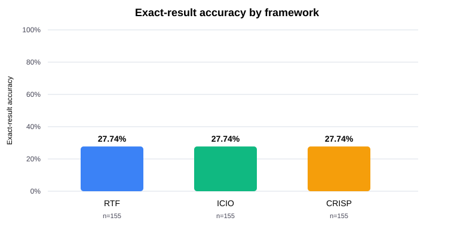
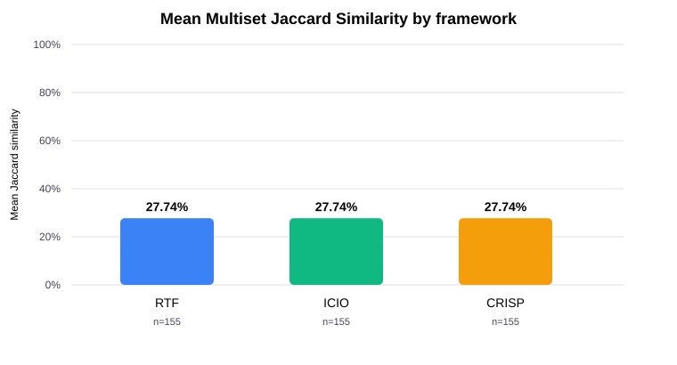
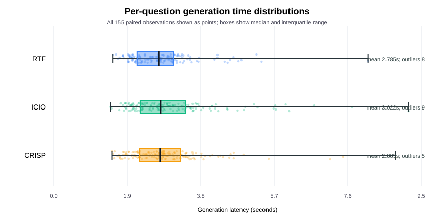
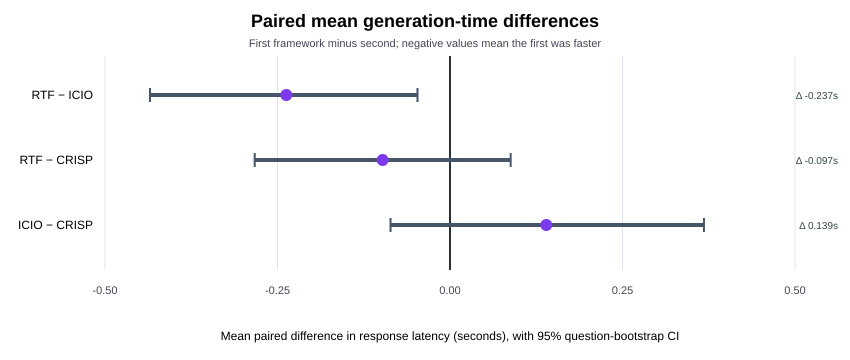

# Task 4: Paired Analysis of Text-to-SQL Prompt Frameworks

## Executive summary

This report reanalyzes only the existing 155-question Task 2 benchmark and Task 3 scores. No Copilot sessions were created and no SQL predictions were generated. The three frameworks have identical exact-correctness outcomes on every question (43/155 each) and identical Task 3 Multiset Jaccard scores on every question. Accordingly, neither correctness metric separates the frameworks in this run. Generation times are the only outcome with observed per-question variation between frameworks; paired nonparametric tests and question-level bootstrap intervals quantify those differences.

## Data and experimental settings

Each CSV contains 155 questions in the original order, has the matching framework label, and records 155 successful generations with parseable nonnegative times. All 465 responses report `gpt-6-luna`; the configured setting was `auto`, not an explicitly pinned model ID. The original evaluator was executed separately on copied inputs for each framework. Its correct counts were cross-checked against independently recomputed per-question exact matches. Task 3's 465 per-question values and summary JSON were also checked against this analysis.

| Framework | CLI agent profile | Copilot session ID | Configured model | Observed response model ID | Questions | Successful generations |
|---|---|---|---|---|---:|---:|
| RTF | `task2-rtf` | `2b34ae28-211f-492f-90c6-6094aa39140c` | `auto` | `gpt-6-luna` | 155 | 155 |
| ICIO | `task2-icio` | `7bed5495-3028-4110-82f3-527ddf8c4c2c` | `auto` | `gpt-6-luna` | 155 | 155 |
| CRISP | `task2-crisp` | `4b93a871-18b2-4f04-b52a-e49dda6383fb` | `auto` | `gpt-6-luna` | 155 | 155 |

| Framework | Prompt file | SHA-256 |
|---|---|---|
| RTF | `prompt_rtf.txt` | `07b39f77b81dd0db521a0e05e8976e84e1ce62f2a7804e990d52b6d6f291e9d8` |
| ICIO | `prompt_icio.txt` | `62f8f92362d389c668b90e06fee868b7cb558fccebe845c0e23de94599f7b189` |
| CRISP | `prompt_crisp.txt` | `b6dafd07ebc163e371b990460ae86fffd67f0013206106be108f0d77ad84187e` |

The three framework prompts share the same schema, relationship guidance, general SQL rules, output constraints, and seven few-shot examples. Their primary planned difference is the organization of those shared instructions under RTF, ICIO, or CRISP. The Task 1 report documents this prompt design.

## Descriptive results

| Framework | Exact correct | Exact accuracy | Mean Jaccard | Median Jaccard | Mean time (s) | Median time (s) |
|---|---:|---:|---:|---:|---:|---:|
| RTF | 43/155 | 27.74% | 0.277420407 | 0.000000 | 2.785465 | 2.721000 |
| ICIO | 43/155 | 27.74% | 0.277420407 | 0.000000 | 3.022129 | 2.769000 |
| CRISP | 43/155 | 27.74% | 0.277420407 | 0.000000 | 2.882897 | 2.756000 |

| Framework | Jaccard = 1 (exact) | Partial (0 < J < 1) | Jaccard = 0 | SQL errors | Failed generations |
|---|---:|---:|---:|---:|---:|
| RTF | 43 | 1 | 111 | 0 | 0 |
| ICIO | 43 | 1 | 111 | 0 | 0 |
| CRISP | 43 | 1 | 111 | 0 | 0 |

The mean and median Jaccard values describe a graded result-overlap measure; they do not replace exact accuracy. All three have the same mean Jaccard (0.277420407), with 43 exact matches, 1 partial match, and 111 zero scores.

## Paired question-level comparison

All frameworks answered the same questions in the same order, so tests and contrasts use paired observations rather than treating the prompt runs as independent samples. RTF and ICIO produced byte-for-byte identical SQL on 137/155 questions; RTF and CRISP on 137/155; ICIO and CRISP on 140/155. All three SQL texts were identical on 131/155 questions.

### Exact-result accuracy

| Test | Comparison | Paired n | Discordant pairs | Statistic | p-value | Effect size | Conclusion |
|---|---|---:|---:|---:|---:|---|---|
| Cochran's Q | RTF, ICIO, CRISP | 155 | 0 | N/A | N/A | N/A | not estimable no discordant outcomes |
| McNemar exact | RTF vs ICIO | 155 | 0 | N/A | N/A | N/A | not informative no discordant pairs |
| McNemar exact | RTF vs CRISP | 155 | 0 | N/A | N/A | N/A | not informative no discordant pairs |
| McNemar exact | ICIO vs CRISP | 155 | 0 | N/A | N/A | N/A | not informative no discordant pairs |

All three correctness vectors are identical question-by-question. Every pair has zero discordant pairs, and the denominator in Cochran's Q is zero; the global test and pairwise McNemar tests are therefore not estimable/informative. This is an observed tie, not evidence that the frameworks are equivalent in general.

### Multiset Jaccard Similarity

| Test | Comparison | Paired n | Statistic | p-value | Holm-adjusted p | Conclusion |
|---|---|---:|---:|---:|---:|---|
| Friedman | RTF, ICIO, CRISP | 155 | N/A | N/A | N/A | not informative all paired differences are zero |
| Wilcoxon signed-rank | RTF vs ICIO | 155 | N/A | N/A | N/A | no nonzero paired differences |
| Wilcoxon signed-rank | RTF vs CRISP | 155 | N/A | N/A | N/A | no nonzero paired differences |
| Wilcoxon signed-rank | ICIO vs CRISP | 155 | N/A | N/A | N/A | no nonzero paired differences |

All 155 per-question Jaccard values are identical across all three frameworks. Every paired difference is zero, so Friedman and Wilcoxon tests provide no estimable framework contrast. The scores add no ranking distinction in this observed run.

## Generation-time analysis

All 155 question-level times were valid for every framework; missing and invalid time counts were zero. Potential extremes were identified using the 1.5×IQR Tukey rule. The plot shows every observation, with the interquartile box, median, and full observed range.

| Framework | n | Min (s) | Q1 (s) | Median (s) | Q3 (s) | Max (s) | Tukey outliers |
|---|---:|---:|---:|---:|---:|---:|---:|
| RTF | 155 | 1.533000 | 2.161500 | 2.721000 | 3.090000 | 8.123000 | 8 |
| ICIO | 155 | 1.469000 | 2.242000 | 2.769000 | 3.417500 | 9.178000 | 9 |
| CRISP | 155 | 1.511000 | 2.219500 | 2.756000 | 3.273500 | 8.833000 | 5 |

The global repeated-measures Friedman test and pairwise Wilcoxon signed-rank tests compare response times question-by-question. The Friedman reference p-value uses its chi-square approximation; Wilcoxon is two-sided with SciPy's `method="auto"` (normal approximation for these 155 nonzero pairs) and no continuity correction. The Wilcoxon signed-rank test evaluates paired differences using their signs and ranks, while Holm correction adjusts the three pairwise p-values to account for multiple comparisons. Kendall's W is reported as the global effect size; paired rank-biserial correlation is the pairwise effect size (negative values indicate lower times for the first-named framework). The 95% paired bootstrap intervals are pointwise percentile intervals for the mean paired time difference, resampling questions as paired units; they are not adjusted for multiple comparisons.

| Test | Comparison | n | Statistic | Raw p-value | Effect size / adjusted p | Conclusion at α = 0.05 |
|---|---|---:|---:|---:|---|---|
| Friedman chi-square | RTF, ICIO, CRISP | 155 | 4.0387 | 0.13274108 | Kendall's W = 0.0130 | not significant at α = 0.05 |
| Wilcoxon signed-rank | RTF vs ICIO | 155 | 4725.50 | 0.018410454 | r_rb = -0.2183; Holm p = 0.055231362 | not significant after Holm |
| Wilcoxon signed-rank | RTF vs CRISP | 155 | 5405.50 | 0.25326577 | r_rb = -0.1058; Holm p = 0.44412881 | not significant after Holm |
| Wilcoxon signed-rank | ICIO vs CRISP | 155 | 5361.50 | 0.2220644 | r_rb = 0.1131; Holm p = 0.44412881 | not significant after Holm |

| Paired contrast (first − second) | n | Mean difference (s) | Median difference (s) | 95% paired bootstrap CI for mean (s) | Faster by observed mean | Holm p | Rank-biserial r |
|---|---:|---:|---:|---:|---|---:|---:|
| RTF − ICIO | 155 | -0.236665 | -0.125000 | [-0.433741, -0.047012] | RTF | 0.055231362 | -0.2183 |
| RTF − CRISP | 155 | -0.097432 | -0.051000 | [-0.282357, 0.087730] | RTF | 0.44412881 | -0.1058 |
| ICIO − CRISP | 155 | 0.139232 | 0.126000 | [-0.085972, 0.367169] | CRISP | 0.44412881 | 0.1131 |

Negative contrasts mean the first-named framework had lower time. The largest observed mean gap was RTF versus ICIO: RTF was 0.236665 s faster on average, about 7.83% of ICIO's mean latency. For this contrast, the 95% pointwise bootstrap interval for the mean paired time difference is [-0.433741, -0.047012] s and excludes zero, while the Holm-adjusted p-value from the Wilcoxon signed-rank test is 0.055231, above α = 0.05. These results need not conflict: the interval is unadjusted for multiple comparisons and concerns the mean paired difference, whereas the Wilcoxon test evaluates signed ranks of paired differences and its p-value is Holm-adjusted across the three pairwise tests. The interval therefore does not override the corrected test conclusion. No statistically significant time difference between any framework pair was confirmed after Holm correction. Statistical significance does not by itself imply practical importance; interpret the estimated seconds and intervals alongside the test results. The bootstrap uses 10,000 paired question-level resamples with fixed seed 20261017.

## Interpretation and possible factors

### Prompt frameworks

The exact correctness vectors and Jaccard score vectors are identical, even though SQL text differs on some questions. In addition, the prompts intentionally share the database schema, relationship rules, most domain-specific instructions, SQL-only format requirement, and all seven demonstrations. Their differences chiefly concern the organization and framing of those contents. The observed high SQL overlap and identical measured outcomes are consistent with the possibility that shared substantive guidance dominated the framework-specific headings. This is a plausible explanation, not a causal finding: the experiment did not independently manipulate instruction content and structure.

### Model and coding agent

GitHub Copilot CLI 1.0.98 was used in three separate named sessions/agent profiles (`task2-rtf`, `task2-icio`, `task2-crisp`). The session records and Task 2 metadata identify the respective agents and prompt hashes. The configured model setting was `auto`; although all responses recorded `gpt-6-luna`, explicit pinning to that model was not achieved. Automatic routing therefore remains a reproducibility limitation and does not guarantee the same model in another run.

The prompt framework, model routing, and Copilot coding-agent environment were not varied in a factorial or repeated experiment. This analysis cannot attribute the outcomes or latency differences separately to the named prompt frameworks, model selection, or agent. Generation time measures observed CLI question-to-complete-response latency, which may include network and service-load variation. Requests were processed sequentially in RTF, ICIO, then CRISP order, so time-of-run/order effects can also be confounded with framework.

### Task 2 and Task 3 together

Task 3 did not add a framework ranking: all three have the same 43 exact outcomes, 111 zero scores, one tiny partial Jaccard score, and the same aggregate Jaccard metrics. This is an observation about this dataset and these responses, not proof that the prompts will always behave identically.

## Limitations and reproducibility

- There is one observed response per question and framework; run-to-run and sampling variability cannot be estimated.
- The model setting was automatic routing. Equal recorded model IDs in this run do not establish a pinned model for the experiment.
- A non-significant test is not evidence of complete equivalence. The identical correctness/Jaccard vectors make the corresponding between-framework tests non-informative for this run.
- Time p-values describe within-run paired response-time differences and do not isolate prompt causality from service conditions or sequential run order.
- The benchmark contains 155 questions from one schema/database; generalization to other Text-to-SQL tasks is untested.
- Prompt organization was compared while substantive instructions and examples were largely shared; this design cannot estimate separate causal effects of headings, rule content, model, or coding agent.

To reproduce the analysis without contacting the model, run `python task4_analysis.py` from this directory using Python 3.14 with SciPy and NumPy available. The script validates the Task 2 CSVs, reruns the unmodified instructor evaluator in temporary isolated directories, recomputes per-question result matches and Jaccard scores using read-only SQLite queries, checks them against Task 2/Task 3 outputs, and regenerates the JSON, report, and SVG figures. The bootstrap seed, replicate count, SciPy version, and NumPy version are recorded in `task4_statistics.json`.
